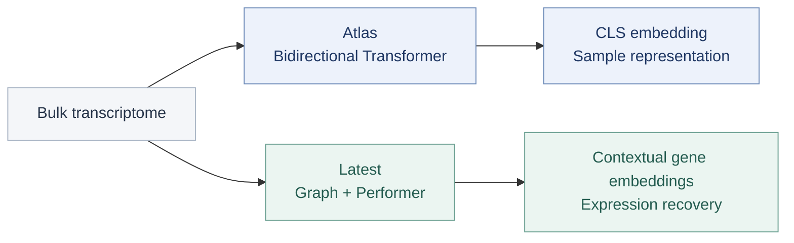

<h1 align="center">BulkFormer</h1>
<p align="center"><strong>Foundation models for bulk transcriptomes</strong><br>Sample representations · Contextual gene embeddings · Expression recovery</p>
<p align="center">Boming Kang · Rui Fan · Meizheng Yi · Chunmei Cui · Qinghua Cui</p>
<p align="center">
  <a href="https://doi.org/10.1016/j.cels.2026.101657"></a>
  <a href="model/README.md"></a>
  <a href="LICENSE"></a>
</p>
<p align="center">
  <a href="#choose-a-model">Models</a> ·
  <a href="#primo-benchmark">Benchmark</a> ·
  <a href="#quick-start">Quick start</a> ·
  <a href="docs/README.md">Documentation</a> ·
  <a href="#contact">Contact</a>
</p>

BulkFormer provides pretrained representations of human bulk transcriptomes. **BulkFormer-Atlas** is our recommended starting point for sample-level prediction; **BulkFormer-Latest** provides contextual gene features and expression recovery. This repository brings both models together with the original publication models.

> **2026-11-06 · Latest checkpoint update:** BulkFormer-Latest now downloads the **final epoch-20 checkpoint**. The architecture and API are unchanged. [Model card](docs/models/latest.md) · [Download guide](model/README.md)
>
> **2026-11-04 · New releases:** BulkFormer-Atlas and BulkFormer-Latest are available with complete weights, inference code and executed GPU tutorials. [Release](https://github.com/KangBoming/BulkFormer/releases/tag/v2026.11.04) · [Announcement](https://github.com/KangBoming/BulkFormer/discussions/13) · [Changelog](CHANGELOG.md)
>
> **Follow model updates:** Select **Watch → Custom → Releases** on this repository. Visit [Announcements](https://github.com/KangBoming/BulkFormer/discussions/categories/announcements) for release news and discussion.

## Choose a model

| Model | Best starting point for | Parameters | Output | Resources |
|---|---|---:|---|---|
| **BulkFormer-Atlas** | Sample and patient-level prediction | **242.37M** | **1,024-d CLS** | [Weights](https://drive.google.com/drive/folders/1OTLnUnnorCqL3nNVK0hfk0Om006WCsrJ) · [Tutorial](notebooks/bulkformer-atlas_sample_embeddings.ipynb) · [Model card](docs/models/atlas.md) |
| **BulkFormer-Latest** | Gene features and expression recovery | **154.55M** | **768-d per-gene embeddings** | [Weights](https://drive.google.com/drive/folders/1wKXEgKk_oPkmaCITi4ASs-05FHl6qkvZ) · [Tutorial](notebooks/bulkformer-latest_feature_extraction.ipynb) · [Model card](docs/models/latest.md) |

Atlas has the stronger aggregate sample-level result on PRIMO. Latest's gene-level recommendation follows its architecture and outputs; a matched gene-level comparison remains to be established.

## Two complementary architectures



| Architecture | Atlas | Latest |
|---|---|---|
| Encoder width / layers / heads | **1,024 / 16 / 16** | **768 / 12 / 12** |
| Coding-gene vocabulary | 22,636 | 19,973 |
| Input | Fixed cohort panel of up to 4,096 genes | Complete available coding transcriptome |

Atlas combines gene identity and expression with a CLS readout. Latest adds global transcriptome context and a gene graph, with missingness-aware expression calibration. [Architecture details](docs/architecture.md) · [Model configurations](configs/README.md)

## PRIMO benchmark

[PRIMO](https://github.com/PRIMOmics/primo-eval) is an open benchmark of omics foundation models for patient-level drug-development tasks. It evaluates sample embeddings with a common downstream prediction protocol across **five task families**: clinical scores, molecular endotypes, perturbation responses, prognosis and treatment outcomes.

The official bulk board contains **59 tasks · 39 cohorts · 4,922 patients**, with **19 ranked entries** as of **2026-11-04**. Our complete submissions cover **44 datasets and 6,390 samples**; these describe submission coverage, while the board reports the scored patient population.

**BulkFormer-Atlas + HVG ranks 1st in this snapshot.** The corresponding official submission name is `BulkFormer-variant + HVG`.

[](https://primomics-primo-eval.hf.space/?tab=leaderboard)

*Official screenshot, 2026-11-04. [Live leaderboard](https://primomics-primo-eval.hf.space/?tab=leaderboard) · [Full-resolution image](docs/assets/primo-official-bulk-leaderboard-20261104.png) · [Capture record](docs/assets/primo-official-bulk-leaderboard-20261104.json)*

<details>
<summary><strong>Submission names and evaluation protocol</strong></summary>

- **Atlas** appears as `BulkFormer-variant`; the **epoch-19 Latest** submission appears as `BulkFormer-V3Plus`. These scores do not evaluate the current final epoch-20 download. Older rows named `BulkFormer-Latest` refer to the archived release.
- **+ HVG** concatenates the embedding with the organizer's **1,200-gene expression baseline**. It is separate from Atlas's 4,096-gene input panel. Atlas alone ranks 8th in this snapshot.
- Rankings can change, and small Elo differences do not establish statistical significance. [Full results and protocol](benchmarks/primo/README.md) document preprocessing, public-task model selection and the limits of the pretraining-overlap audit.

</details>

## Quick start

```bash
git clone https://github.com/KangBoming/BulkFormer.git
cd BulkFormer
conda env create -f configs/inference.yaml
conda activate bulkformer
pip install -e . --no-deps
jupyter lab
```

Choose the [Atlas tutorial](notebooks/bulkformer-atlas_sample_embeddings.ipynb) or the [Latest tutorial](notebooks/bulkformer-latest_feature_extraction.ipynb). Both include executed GPU outputs on synthetic examples.

```python
from bulkformer import download_model

download_model("atlas")   # model/atlas/
download_model("latest")  # model/latest/
```

Each Google Drive release provides a **single complete FP32 weight file**, architecture configuration, gene resources, inference environment and checksums. [Download guide](model/README.md).

### How many genes should I provide?

Start with the **complete available expression matrix** and pass it to the model's preparation function before selecting genes.

| Model | Recommended number of genes | How to prepare the input |
|---|---|---|
| **Atlas** | **4,096 selected coding genes** per sample | Normalize the full available matrix with `prepare_atlas_input`, then select genes from the 22,636-gene coding vocabulary. The released extraction API accepts **at most 4,096 genes**; reuse the same gene list across samples you want to compare. |
| **Latest** | **As close as possible to all 19,973 coding genes** (about 20,000) | Pass the complete available coding transcriptome to `prepare_latest_input`. It aligns the data to all 19,973 model positions and marks unavailable genes as missing. Select HVG/DEG embeddings **after** full-transcriptome encoding. |

For Atlas, lower `n_genes` if fewer than 4,096 shared variable genes are available. For Latest, missing genes are supported, but filling their positions does not restore the missing measurements. In both models, preserve measured zeros and check the returned `coverage` table. [Input guide](docs/input-guide.md).

### Atlas · sample embeddings

```python
import pandas as pd
from bulkformer import load_atlas, prepare_atlas_input, select_variable_genes, extract_atlas

model, vocab, normalization_vocab = load_atlas("model/atlas", device="cuda")
counts = pd.read_csv("examples/demo_counts.csv", index_col=0)
expression, coverage = prepare_atlas_input(counts, vocab, normalization_vocab, input_scale="counts")
panel = select_variable_genes(expression, n_genes=4096)
sample_embeddings = extract_atlas(model, expression, panel, batch_size=2)
```

Save the selected gene IDs with the embeddings and reuse that gene list when processing additional samples. [Atlas tutorial](notebooks/bulkformer-atlas_sample_embeddings.ipynb).

### Latest · contextual gene embeddings

```python
import pandas as pd
from bulkformer import load_latest, prepare_latest_input, extract_latest

model, vocab = load_latest("model/latest", device="cuda")
counts = pd.read_csv("examples/demo_counts.csv", index_col=0)
expression, coverage = prepare_latest_input(counts, vocab, input_scale="counts")
genes = vocab.index[vocab["symbol"].isin(["TP53", "EGFR", "BRCA1"])].to_numpy()
outputs = extract_latest(model, expression, gene_indices=genes,
                         return_expression=True, batch_size=1)
gene_embeddings = outputs["gene_embeddings"]
```

> **Input coverage matters.** Give Latest the complete available coding transcriptome, then select HVG/DEG embeddings for pooling. Preserve measured zeros and mark unavailable genes as missing. Use each model's preparation function for its vocabulary and expression scale. [Input guide](docs/input-guide.md)

## Original model family

These are the models associated with the original BulkFormer publication. Their downloads, environment and [original feature-extraction notebook](bulkformer_extract_feature.ipynb) remain available for reproducibility.

| Model | Parameters | Hidden width | Layers | Heads | Weights |
|---|---:|---:|---:|---:|---|
| BulkFormer-37M | 37M | 128 | 1 | 8 | [Google Drive](https://drive.google.com/file/d/1qY2qaXfKfDot9EMcOF9gr8T0jghrH7km/view) |
| BulkFormer-50M | 50M | 256 | 2 | 8 | [Google Drive](https://drive.google.com/file/d/12ZYGYrZIQJyodaVicrJpnY_8_JG-hamK/view) |
| BulkFormer-93M | 93M | 512 | 6 | 8 | [Google Drive](https://drive.google.com/file/d/1s_3XoMaHiBfxi5C8D3bgwwzNrihafaIk/view) |
| BulkFormer-127M | 127M | 640 | 8 | 8 | [Google Drive](https://drive.google.com/file/d/1-5AdgIpkm8dOm9tuwOXcqS1sUyGN6vHg/view) |
| BulkFormer-147M | 147M | 640 | 12 | 8 | [Google Drive](https://drive.google.com/file/d/1UtqN_vCh3669Fs-GU5CTE7F7UnuQCAzN/view) |

[Original paper results and setup](docs/original-paper.md) · [Release history](CHANGELOG.md) · [Migration from the previous Latest release](docs/migration.md).

## Citation

Kang, B., Fan, R., Yi, M., Cui, C., & Cui, Q. **BulkFormer: A large-scale foundation model for bulk transcriptomes.** *Cell Systems*, 101657 (2026). [DOI](https://doi.org/10.1016/j.cels.2026.101657).

Atlas and the current Latest checkpoint are subsequent research releases. Please also report the model name, checkpoint ID and evaluation protocol. Code is available under the [MIT license](LICENSE).

## Contact

- **Boming Kang** — [kangbm@bjmu.edu.cn](mailto:kangbm@bjmu.edu.cn)
- **Qinghua Cui** — [cuiqinghua@bjmu.edu.cn](mailto:cuiqinghua@bjmu.edu.cn)

