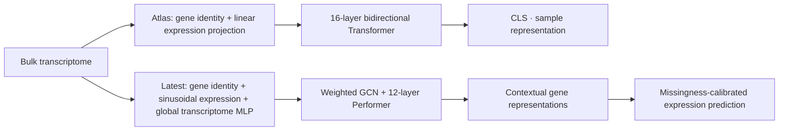
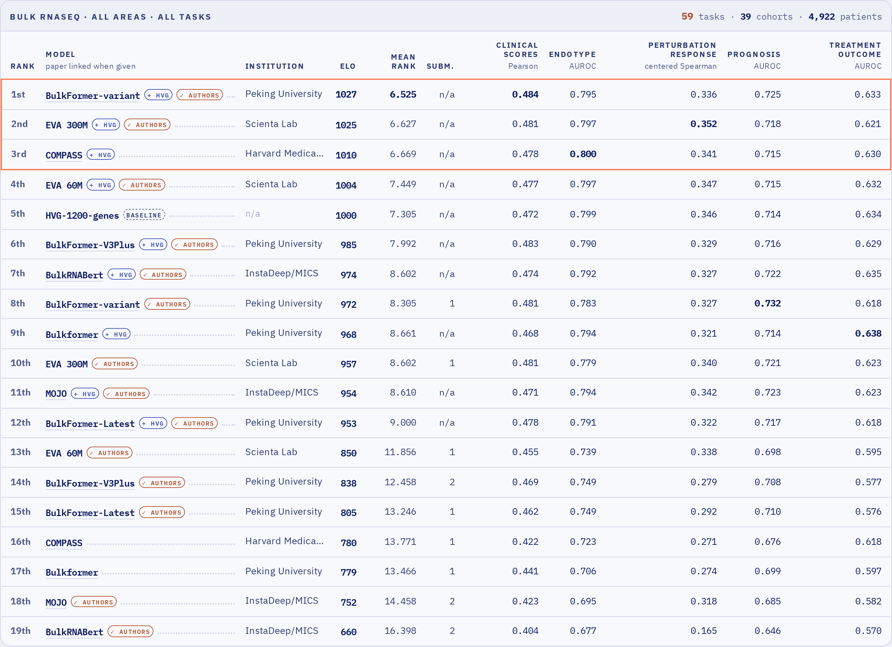

<h1 align="center">BulkFormer</h1>
<p align="center"><strong>Foundation models for bulk transcriptomes — from samples to genes</strong></p>
<p align="center">Boming Kang · Rui Fan · Meizheng Yi · Chunmei Cui · Qinghua Cui</p>
<p align="center">
<a href="https://doi.org/10.1016/j.cels.2026.101657">Original paper</a> ·
<a href="#choose-a-model">Models</a> ·
<a href="#primo-benchmark">PRIMO</a> ·
<a href="#quick-start">Quick start</a> ·
<a href="docs/README.md">Documentation</a>
</p>

BulkFormer is a family of pretrained models for human bulk transcriptomes. **BulkFormer-Atlas** is our recommended starting point for sample-level representation learning. **BulkFormer-Latest** provides full-transcriptome contextual gene representations and expression predictions. This repository is the entry point for both models and the original publication models.

## News

**2026-11-04 — Introducing BulkFormer-Atlas and the new BulkFormer-Latest.** Atlas uses a 242.37M-parameter Transformer trained with paired views, expression reconstruction and symmetric InfoNCE. Latest uses a 154.55M-parameter graph–Performer encoder with global expression context and missingness-conditioned output calibration.

**Atlas + HVG ranks 1st of 19 entries on the PRIMO bulk leaderboard** in the 2026-11-04 snapshot. Atlas alone ranks 8th. The official entries are currently named `BulkFormer-variant` and `BulkFormer-variant + HVG`. [Results and protocol](benchmarks/primo/README.md) · [Live leaderboard](https://primomics-primo-eval.hf.space/?tab=leaderboard).

## Choose a model

| Model | Primary workflow | Parameters | Representation | Checkpoint | Resources |
|---|---|---:|---|---|---|
| **BulkFormer-Atlas** | **Sample-level features** for phenotype and patient-level prediction | **242.37M** | Native **1,024-d CLS** | Epoch 10 / update 320,000 | [Model card](docs/models/atlas.md) · [Weights](https://drive.google.com/drive/folders/1OTLnUnnorCqL3nNVK0hfk0Om006WCsrJ) · [GPU notebook](notebooks/bulkformer-atlas_sample_embeddings.ipynb) |
| **BulkFormer-Latest** | **Gene-level contextual features**, expression recovery, optional sample pooling | **154.55M** | **768-d per-gene vectors** and expression values | Epoch 19 / update 140,885 | [Model card](docs/models/latest.md) · [Weights](https://drive.google.com/drive/folders/1wKXEgKk_oPkmaCITi4ASs-05FHl6qkvZ) · [GPU notebook](notebooks/bulkformer-latest_feature_extraction.ipynb) |

These are workflow recommendations based on the objectives and available evaluations. Both models have gene and sample representations; this table does not claim that either model wins every task. Atlas has the stronger PRIMO aggregate result. A matched gene-level comparison between these two checkpoints has not yet been completed.

## Two complementary architectures



| Configuration | BulkFormer-Atlas | BulkFormer-Latest |
|---|---|---|
| Coding-gene vocabulary | 22,636 | 19,973 |
| Input per forward pass | 4,096 genes + CLS in the released PRIMO workflow | All 19,973 gene positions |
| Encoder width / layers / heads | 1,024 / 16 / 16 | 768 / 12 / 12 |
| Attention | Full bidirectional self-attention | Performer, 256 random features per head |
| Feed-forward block | SwiGLU, hidden width 2,816 | Performer feed-forward, width 3,072 |
| Graph / global expression branch | None | Weighted GCN, hidden width 256; MLP 19,973 → 2,560 → 768 |
| Input fusion | Gene ID + expression, followed by RMSNorm | Three separately normalized branches, fixed coefficients **1:1:1**, then LayerNorm |
| Sample representation | Trained CLS, before the 512-d contrastive head | Pool observed contextual gene embeddings |
| Expression scale | **log2(TPM + 1)** | **natural ln(TPM + 1)** |
| Main objectives | Masked MSE + CLS-conditioned reconstruction MSE + symmetric InfoNCE | Masked-expression MSE with missingness-conditioned prediction calibration |

Atlas follows a Pandora-inspired paired-view framework, with a symmetric InfoNCE objective and our model scale, coding-gene vocabulary and training configuration. The detailed [architecture comparison](docs/architecture.md) distinguishes inherited components from implementation changes.

## Pretraining configuration

| Setting | BulkFormer-Atlas | BulkFormer-Latest |
|---|---|---|
| Training samples | 1,028,046 ARCHS4 profiles | 711,826 profiles from ARCHS4, DiSignAtlas, GDC and GTEx |
| Validation | 1,548 profiles; GSE groups disjoint from training | 3,746 ID + 3,602 OOD profiles |
| Training objective weights | Masked : constructive : contrastive = **1:1:1** | Masked MSE |
| Views and masking | 2 independently sampled 4,096-gene views; 20% token dropout; 20% masking among retained genes | Per-sample mask rate uniform in **10–20%**, mean 15% |
| Augmentation | Gene- and sample-specific Gaussian noise, scale 0.1 | Dynamic expression masking |
| Optimizer | AdamW, β=(0.9, 0.95), weight decay 0.05 | AdamW, β=(0.9, 0.95), weight decay 0.01 |
| Learning rate | 3% linear warmup to 1e-4, cosine decay to 1e-5 | 1% linear warmup to 1e-4, then **constant** |
| Training batch | 4 GPUs × 8 samples; global batch 32; 2 views per sample | 1 GPU × 4 samples × 24 accumulation steps; effective batch 96 |
| Precision / gradient clipping | BF16 / 1.0 | BF16 / 1.0 |
| Planned budget / released checkpoint | 40 epochs planned / **epoch 10** | 20 epochs planned / **epoch 19** |
| Checkpoint selection | Minimum validation total loss | Minimum mean ID/OOD MSE at 10% masking |

The epoch-40 Atlas run name records its planned budget; it does not mean 40 epochs were completed. Latest is pinned to the best completed checkpoint at release time, not a moving training file. [Training configurations](configs/README.md) include the exact release identities and validation settings.

## PRIMO benchmark

[PRIMO](https://github.com/PRIMOmics/primo-eval) is an open benchmark of omics foundation-model representations for patient-level drug-development tasks. Each model supplies sample embeddings, and the same downstream predictor evaluates them; most task labels remain private. The bulk RNA-seq board covers **five task families**: clinical score prediction, molecular endotype classification, perturbation response prediction, prognosis, and treatment outcome prediction.

The official bulk board reports **59 tasks across 39 cohorts and 4,922 patients**, with **19 leaderboard entries**, as of **2026-11-04**. Our complete embedding submissions cover **44 datasets and 6,390 samples**; these counts describe the submitted data, while the screenshot reports the scored view.

[](https://primomics-primo-eval.hf.space/?tab=leaderboard)

*Direct screenshot of the official page, with all ranked entries and original submission names preserved. Click the image to open the live board. [Full-resolution image](docs/assets/primo-official-bulk-leaderboard-20261104.png) · [Capture record](docs/assets/primo-official-bulk-leaderboard-20261104.json).*

`+ HVG` means the official evaluator concatenates the model representation with its **1,200-gene expression baseline**. It is distinct from Atlas's **4,096-gene input panel**. Atlas alone is not the overall first-place entry. Ranks and Elo change as submissions change; a small Elo difference does not establish statistical significance.

The leaderboard aliases are **Atlas = BulkFormer-variant** and **Latest = BulkFormer-V3Plus**. Latest's entry uses the same epoch-19 checkpoint released here; the older rows named `BulkFormer-Latest` belong to the archived release. [Category metrics, checkpoint hashes and evaluation details](benchmarks/primo/README.md) record input-scale exceptions, public-task model selection and the unaudited possibility of pretraining overlap. These scores are separate from the original paper benchmark.

## Quick start

```bash
git clone https://github.com/KangBoming/BulkFormer.git
cd BulkFormer
conda env create -f configs/inference.yaml
conda activate bulkformer
pip install -e . --no-deps
jupyter lab
```

Choose the [Atlas sample notebook](notebooks/bulkformer-atlas_sample_embeddings.ipynb) or the [Latest gene notebook](notebooks/bulkformer-latest_feature_extraction.ipynb). Both contain executed GPU outputs from eight synthetic profiles: coverage, selected genes, embedding shapes and numerical previews. The demo is not a biological benchmark.

```python
from bulkformer import download_model

download_model("atlas")   # model/atlas/
download_model("latest")  # model/latest/
```

Each Google Drive folder contains **one complete FP32 `model.pt`**, configuration, required gene/graph resources, environment, training metadata and SHA256 checksums. Optimizer states and training samples are excluded. [Manual download guide](model/README.md).

### Atlas: sample embeddings

```python
import pandas as pd
from bulkformer import load_atlas, prepare_atlas_input, select_variable_genes, extract_atlas

model, vocab, normalization_vocab = load_atlas("model/atlas", device="cuda")
counts = pd.read_csv("examples/demo_counts.csv", index_col=0)
expression, coverage = prepare_atlas_input(counts, vocab, normalization_vocab, input_scale="counts")
panel = select_variable_genes(expression, n_genes=4096)
sample_embeddings = extract_atlas(model, expression, panel, batch_size=2)
```

Use a fixed panel for a cohort. For prospective supervised evaluation, select it on training samples and reuse it on held-out samples. PRIMO used unlabeled whole-cohort selection. [Atlas input guide](docs/input-guide.md#atlas).

### Latest: contextual gene embeddings

```python
import pandas as pd
from bulkformer import load_latest, prepare_latest_input, extract_latest

model, vocab = load_latest("model/latest", device="cuda")
counts = pd.read_csv("examples/demo_counts.csv", index_col=0)
expression, coverage = prepare_latest_input(counts, vocab, input_scale="counts")
genes = vocab.index[vocab["symbol"].isin(["TP53", "EGFR", "BRCA1"])].to_numpy()
outputs = extract_latest(model, expression, gene_indices=genes,
                         return_expression=True, batch_size=1)
gene_embeddings = outputs["gene_embeddings"]
```

Provide the **complete available coding transcriptome** to Latest. Select HVGs/DEGs from the contextual outputs after full-axis encoding. Missing values are distinct from measured zeros. The two models have different vocabularies and log bases: use their respective preparation functions. [Input guide](docs/input-guide.md).

## Original model family

These are the models associated with the original BulkFormer publication. Their downloads, environment and [original feature-extraction notebook](bulkformer_extract_feature.ipynb) remain available for reproducibility.

| Model | Parameters | Hidden width | Layers | Heads | Weights |
|---|---:|---:|---:|---:|---|
| BulkFormer-37M | 37M | 128 | 1 | 8 | [Google Drive](https://drive.google.com/file/d/1qY2qaXfKfDot9EMcOF9gr8T0jghrH7km/view) |
| BulkFormer-50M | 50M | 256 | 2 | 8 | [Google Drive](https://drive.google.com/file/d/12ZYGYrZIQJyodaVicrJpnY_8_JG-hamK/view) |
| BulkFormer-93M | 93M | 512 | 6 | 8 | [Google Drive](https://drive.google.com/file/d/1s_3XoMaHiBfxi5C8D3bgwwzNrihafaIk/view) |
| BulkFormer-127M | 127M | 640 | 8 | 8 | [Google Drive](https://drive.google.com/file/d/1-5AdgIpkm8dOm9tuwOXcqS1sUyGN6vHg/view) |
| BulkFormer-147M | 147M | 640 | 12 | 8 | [Google Drive](https://drive.google.com/file/d/1UtqN_vCh3669Fs-GU5CTE7F7UnuQCAzN/view) |

[Original paper results and setup](docs/original-paper.md) · [Release history](CHANGELOG.md) · [Migration from the previous Latest release](docs/migration.md).

## Citation and contact

For the original BulkFormer model family, cite:

Kang, B., Fan, R., Yi, M., Cui, C., & Cui, Q. **BulkFormer: A large-scale foundation model for bulk transcriptomes.** *Cell Systems*, 101657 (2026). [DOI](https://doi.org/10.1016/j.cels.2026.101657).

Atlas and the current Latest checkpoint are subsequent research releases and were not evaluated as these checkpoints in the original paper. Report the model name, immutable checkpoint ID and evaluation protocol when using them. Atlas's model card acknowledges its Pandora-inspired training framework.

Code: [MIT](LICENSE). Contact: [Boming Kang](mailto:kangbm@bjmu.edu.cn) · [Qinghua Cui](mailto:cuiqinghua@bjmu.edu.cn).
